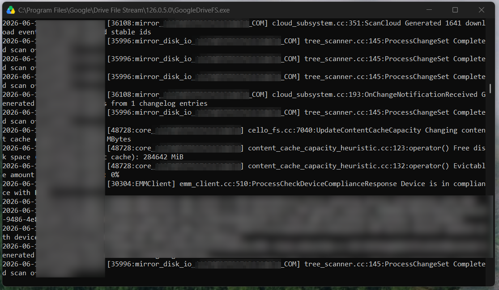

# Google Drive for desktop (Windows): console window that cannot be closed

Evidence for a long-standing (at least since 2023) defect in Google Drive for desktop on Windows. `GoogleDriveFS.exe` allocates a console window on every child-process start. When the window is visible and the user closes it, the child exits, the parent restarts it with a new window, and after seven restarts Drive stops running until the next sign-in.

## Summary

Every DriveFS child process allocates a console on startup. The DriveFS log records this itself:

```
instrumentation.cc:376:GetStderrFileDescriptor Allocating console to enable stderr.
```

This line appears in 155 of 155 child-process logs retained on this machine (2026-07-21 to 2026-10-21). When that console window is visible, the user sees a black window titled `C:\Program Files\Google\Drive File Stream\<version>\GoogleDriveFS.exe` that fills with log output. Closing it sends the console close event to the child, which exits with `0xC000013A` (STATUS_CONTROL_C_EXIT). The parent process treats that as a crash and starts a new child, which opens a new console window. After 7 restarts the parent stops restarting, and Drive is down until the next sign-in.

So the user-visible defect is a window that "cannot be closed", and the consequence of trying is that Drive dies.





**Read the report:** [REPORT-google-drive-console-window.md](REPORT-google-drive-console-window.md)


## Status

Reported through Drive's in-app feedback on 14 separate days between July and October 2026 (26 delivered reports, every one with diagnostic logs attached), and three times by other users in the Google Drive Help Community (threads 417837966, 434801725, 445097711). No fix as of 2026-10-21 on version 132.0.0.0. On that date the window appeared on its own after a scheduled restart and was captured live (see `live-capture-2026-10-21.md`); closing it afterwards ran the seven-restart loop and left Drive stopped.

## What has been tried on this machine

None of it helps. The console is allocated by the application itself, so there is nothing on the user's side that prevents it (report, sections 3, 4 and 7).

- **Clean reinstall, 2026-06-02.** Drive uninstalled, the install directory and `%LOCALAPPDATA%\Google\DriveFS` deleted, Drive reinstalled. The window was back within two weeks on the fresh 126.0.5.0 install.
- **Every update since.** 128.0.0.0 through 132.0.0.0. The behaviour is identical on all of them.
- **Launching the parent with a hidden window and stderr redirected to a file.** The child still allocates its own console. The first child's window stays hidden, but the next self-requested restart (DriveFS does this every few hours) starts a child with a visible one.
- **Hiding the window with `ShowWindow(SW_HIDE)`.** Drive keeps running, but the window returns with the next child restart.
- **Default terminal setting.** Checked and not involved: the host is `conhost.exe`, Windows Terminal is not attached, and the setting is "Let Windows decide".
- **Shortcuts and startup entries.** Every shortcut and executable reference to `GoogleDriveFS.exe`, including the autostart (Run key) entry, was checked. None carries a debug, verbose or logging flag, or any argument at all beyond Drive's own `--startup_mode` on the autostart entry. The child's command line is built by the parent and is the same on every start.
- **Waiting for the process to finish.** The process never finishes that I know of. It freezes and will stay there for days at least. It only stops after manually killing 7 times in a row. 